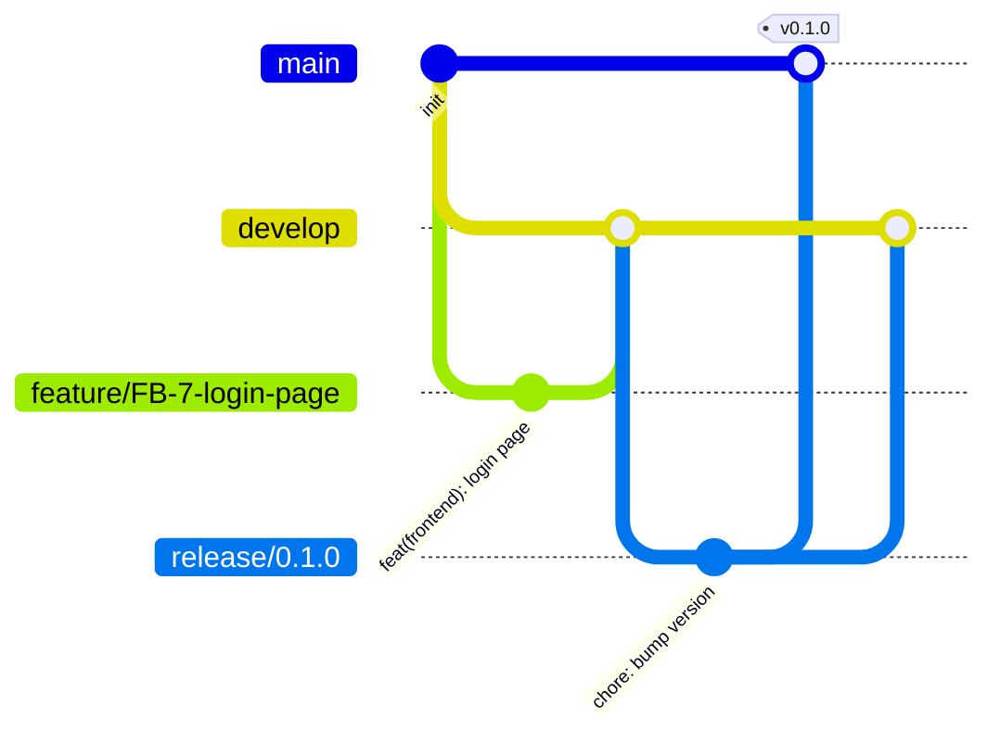
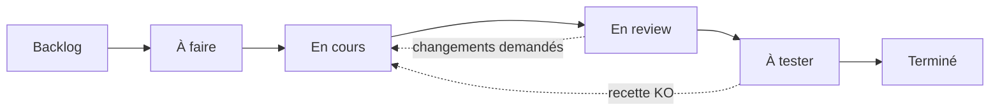

# 📘 Facebook like

Réseau social inspiré de Facebook : **React** (frontend) + **Next.js** (API backend).


📋 **Backlog Notion :** [Facebook like — Backlog](https://app.notion.com/p/TrustSign-be7f6c85647e452898f97fe4be416485?source=copy_link)

## Sommaire

- [Contexte](#-contexte)
- [Fonctionnalités](#-fonctionnalités)
- [Installation](#-installation)
- [Branching strategy](#-branching-strategy)
- [Workflow des tickets](#-workflow-des-tickets)
- [Automatisations](#-automatisations)
- [Documentation](#-documentation)

---

## 🎯 Contexte

Projet de groupe : concevoir un réseau social simplifié reprenant les usages clés de Facebook (compte, publications, fil d'actualité, interactions, amis).

| Rôle | Responsabilité |
|---|---|
| **Product Owner** | Rédige et priorise le backlog Notion, valide les tickets |
| **Dev Back** | API Next.js, base de données, sécurité |
| **Dev Front** | Interface React, intégration de l'API |

La gestion de projet se fait sur **Notion** : chaque EPIC contient des sous-tâches front et back. Chaque ticket a un identifiant unique **`FB-<id>`**, repris dans le nom des branches et des Pull Requests.

## ✨ Fonctionnalités

| EPIC | Contenu | Priorité |
|---|---|:-:|
| 🔐 Authentification | Inscription, connexion (JWT), déconnexion | P0 |
| 📰 Fil d'actualité | Publier, fil paginé, supprimer | P0 |
| 👤 Profil | Page profil, édition, avatar | P1 |
| 👍 Interactions | Likes, commentaires | P1 |
| 🤝 Amis | Recherche, demandes d'amis | P2 |

Le découpage en releases est détaillé dans la [story map](docs/STORYMAP.md).

## 🚀 Installation

### Prérequis

| Outil | Version | Vérification |
|---|---|---|
| Node.js | ≥ 20 (22 recommandé, cf. `.nvmrc`) | `node -v` |
| npm | ≥ 10 | `npm -v` |
| Git | ≥ 2.30 | `git --version` |
| PostgreSQL | 16 (ou Docker) | `psql --version` |

### Lancer avec Docker (le plus simple)

```bash
git clone https://github.com/Miisterone/Gestion-de-projet.git
cd Gestion-de-projet
docker compose up -d --build
```

### Lancer le projet

```bash
git clone https://github.com/Miisterone/Gestion-de-projet.git
cd Gestion-de-projet
git checkout develop
nvm use                                    # optionnel : utilise la version de .nvmrc
npm install                                # installe front + back
cp frontend/.env.example frontend/.env
cp backend/.env.example backend/.env
docker compose up -d db                    # PostgreSQL (ou une instance locale, cf. DATABASE_URL)
npm run db:migrate -w backend              # crée les tables
npm run db:seed -w backend                 # comptes de démo (mot de passe : localloop)
npm run dev                                # lance front + back
```

### Vérifier que tout fonctionne

| Service | URL | Résultat attendu |
|---|---|---|
| Frontend | http://localhost:5173 | Page d'accueil |
| Backend | http://localhost:3001/api/health | `{ "status": "ok" }` |

### Commandes

| Commande | Rôle |
|---|---|
| `npm run dev` | Lance front + back en mode dev |
| `npm run docs` | Régénère la doc de l'API ([docs/API.md](docs/API.md)) |
| `npm run db:migrate -w backend` | Applique les migrations PostgreSQL |
| `npm run db:generate -w backend` | Génère une migration après modification du schéma |
| `npm run db:seed -w backend` | Ajoute les données de démonstration |

Le schéma et le choix de l'ORM (Drizzle) sont décrits dans [docs/DATABASE.md](docs/DATABASE.md).

### Structure

```text
Gestion-de-projet/
├── frontend/   # React + Vite (servi par nginx en production)
├── backend/    # Next.js (routes API dans app/api/, base dans db/)
├── docs/       # Personas, story map, doc de l'API…
├── scripts/    # Génération de la doc de l'API
└── .github/    # CI/CD et automations
```

## 🌿 Branching strategy

Nous suivons **GitFlow** : deux branches permanentes (`main`, `develop`) et des branches courtes, une par ticket Notion.

| Branche | Rôle | Créée depuis | Fusionnée vers |
|---|---|---|---|
| `main` | Versions stables livrées, taguées | — | — |
| `develop` | Intégration des fonctionnalités du sprint | `main` | — |
| `feature/FB-<id>-<desc>` | Une fonctionnalité = un ticket Notion | `develop` | `develop` |
| `fix/FB-<id>-<desc>` | Correction pendant le développement | `develop` | `develop` |
| `release/x.y.z` | Stabilisation d'une version | `develop` | `main` + `develop` |
| `hotfix/FB-<id>-<desc>` | Correctif urgent en production | `main` | `main` + `develop` |



**Règles essentielles :**

- Pas de push direct sur `main` ni `develop` : **Pull Request + 1 review + CI verte** obligatoires.
- Commits au format [Conventional Commits](https://www.conventionalcommits.org/en/v1.0.0/), **en anglais** : `feat(frontend): add profile page`.
- Versions en **Semantic Versioning** `MAJEUR.MINEUR.CORRECTIF` (ex. `v1.2.0`).

👉 Toutes les conventions détaillées sont dans **[CONTRIBUTING.md](CONTRIBUTING.md)**.

## 🔄 Workflow des tickets



| Statut | Qui | Action |
|---|---|---|
| **Backlog** | PO | Crée le ticket, le rattache à son EPIC |
| **À faire** | Équipe | Ticket choisi en sprint planning |
| **En cours** | Dev | Crée sa branche `feature/FB-<id>-<desc>` |
| **En review** | Dev | Ouvre la PR vers `develop` 🤖 |
| **À tester** | PO | PR fusionnée, le PO vérifie 🤖 |
| **Terminé** | PO | Validé |

🤖 = statut mis à jour automatiquement par GitHub Actions.

## 🤖 Automatisations

Toutes les automatisations sont des workflows GitHub Actions dans [.github/workflows/](.github/workflows/).

| Workflow | Quand | Ce qu'il fait |
|---|---|---|
| [CI](.github/workflows/ci.yml) | Chaque PR et push sur `main` / `develop` | Vérifie que la doc de l'API est à jour |
| [PR check](.github/workflows/pr-check.yml) | Ouverture / modification d'une PR | Vérifie le nom de la branche et le titre (Conventional Commits), ajoute les labels `frontend` / `backend` / `infra` / `documentation` |
| [Notion](.github/workflows/notion.yml) | PR ouverte / mergée | Passe le ticket `FB-<id>` de la branche en **En review** puis **À tester** |
| [Docker](.github/workflows/docker.yml) | Push sur `main` ou tag `v*` | Build les images front et back et les publie sur GitHub Container Registry |
| [Release](.github/workflows/release.yml) | Tag `v*` | Crée la release GitHub avec la liste des PR, classées par label |
| [Dependabot](.github/dependabot.yml) | Chaque semaine | Ouvre des PR pour mettre à jour les dépendances |

**Performances de la CI :** cache Docker entre les builds, et annulation du run précédent quand un nouveau commit est poussé sur la même branche.

**Orchestration ([docker-compose.yml](docker-compose.yml)) :** un conteneur par service, en mode production.

- Le back attend d'être *healthy* (healthcheck sur `/api/health`) avant que le front démarre.
- Redémarrage automatique en cas de crash, limites de CPU et de mémoire.
- Le front est servi par nginx avec compression gzip et cache long sur les fichiers JS / CSS.
- Les données sont gardées dans un volume Docker.

**Documentation automatique :** `npm run docs` lit les routes de `backend/app/api` et génère [docs/API.md](docs/API.md). La CI échoue si la doc n'a pas été régénérée après un changement d'API. Les notes de version sont générées à chaque release.

**Configuration Notion** (une seule fois) : créer une intégration Notion, la connecter à la base des tickets, puis ajouter les secrets `NOTION_TOKEN` et `NOTION_DATABASE_ID` dans *Settings → Secrets and variables → Actions*. La base doit avoir une colonne `ID` (type *ID unique*, préfixe `FB`) et une colonne `Statut` (type *Statut*). Les noms sont modifiables en haut de [notion-status.mjs](.github/scripts/notion-status.mjs).

## 📚 Documentation

| Document | Contenu |
|---|---|
| [CONTRIBUTING.md](CONTRIBUTING.md) | Branches, commits, Pull Requests, versions |
| [docs/PERSONAS.md](docs/PERSONAS.md) | Nos 3 personas et leurs besoins |
| [docs/STORYMAP.md](docs/STORYMAP.md) | Parcours utilisateur et découpage en releases |
| [docs/API.md](docs/API.md) | Routes de l'API (générée automatiquement) |
