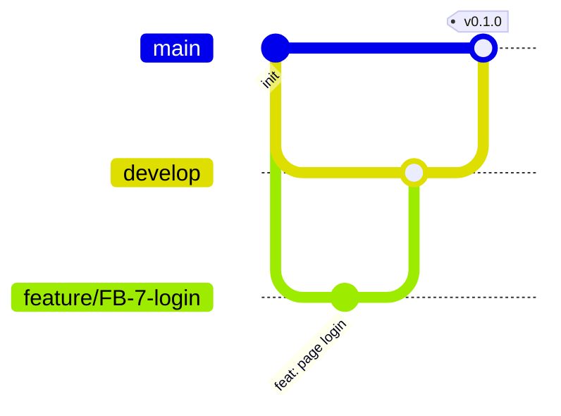
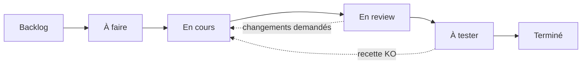

# Gestion-de-projet

Lien Notion : https://app.notion.com/p/TrustSign-be7f6c85647e452898f97fe4be416485?source=copy_link

# 📘 Facebook-like

Réseau social inspiré de Facebook : **React** (frontend) + **Next.js** (API backend).


## Sommaire

- [Contexte](#-contexte)
- [Fonctionnalités](#-fonctionnalités)
- [Installation](#-installation)
- [Branching strategy](#-branching-strategy)
- [Workflow des tickets](#-workflow-des-tickets)

---

## 🎯 Contexte

Projet de groupe : concevoir un réseau social simplifié reprenant les usages clés de Facebook (compte, publications, fil d'actualité, interactions, amis).

| Rôle | Responsabilité |
|---|---|
| **Product Owner** | Rédige et priorise le backlog Notion, valide les tickets |
| **Dev Back** | API Next.js, base de données, sécurité |
| **Dev Front** | Interface React, intégration de l'API |

La gestion de projet se fait sur **Notion** : chaque EPIC contient des sous-tâches front et back.

## ✨ Fonctionnalités

| EPIC | Contenu | Priorité |
|---|---|:-:|
| 🔐 Authentification | Inscription, connexion (JWT), déconnexion | P0 |
| 📰 Fil d'actualité | Publier, fil paginé, supprimer | P0 |
| 👤 Profil | Page profil, édition, avatar | P1 |
| 👍 Interactions | Likes, commentaires | P1 |
| 🤝 Amis | Recherche, demandes d'amis | P2 |

## 🚀 Installation

**Prérequis :** Node.js ≥ 20, npm, Git.

```bash
git clone https://github.com/<organisation>/facebook-like.git
cd facebook-like
git checkout develop
npm install                                # installe front + back
cp frontend/.env.example frontend/.env
cp backend/.env.example backend/.env
npm run dev                                # lance front + back
```

| Service | URL |
|---|---|
| Frontend | http://localhost:5173 |
| Backend | http://localhost:3001/api/health |

**Structure :**

```text
facebook-like/
├── frontend/   # React + Vite
├── backend/    # Next.js (routes API dans app/api/)
└── .github/    # CI et automations
```

## 🌿 Branching strategy

Git Flow simplifié : deux branches permanentes, une branche courte par ticket.

| Branche | Rôle | Part de → merge vers |
|---|---|---|
| `main` | Version stable, taguée à chaque release | — |
| `develop` | Intégration des fonctionnalités du sprint | `main` → `main` |
| `feature/FB-<id>-<desc>` | Une fonctionnalité = un ticket Notion | `develop` → `develop` |
| `fix/FB-<id>-<desc>` | Correction de bug | `develop` → `develop` |
| `hotfix/FB-<id>-<desc>` | Correctif urgent en production | `main` → `main` + `develop` |



**Règles :**

- Pas de push direct sur `main` ni `develop` : **Pull Request + 1 review** obligatoires.
- `FB-<id>` = identifiant du ticket Notion (ex. `feature/FB-12-page-profil`).
- Commits au format [Conventional Commits](https://www.conventionalcommits.org/fr/) : `feat(front): ajoute la page profil`.

## 🔄 Workflow des tickets



| Statut | Qui | Action |
|---|---|---|
| **Backlog** | PO | Crée le ticket, le rattache à son EPIC |
| **À faire** | Équipe | Ticket choisi en sprint planning |
| **En cours** | Dev | Crée sa branche `feature/FB-xx-…` |
| **En review** | Dev | Ouvre la PR vers `develop` 🤖 |
| **À tester** | PO | PR mergée, le PO vérifie 🤖 |
| **Terminé** | PO | Validé |

🤖 = statut mis à jour automatiquement par GitHub Actions.
