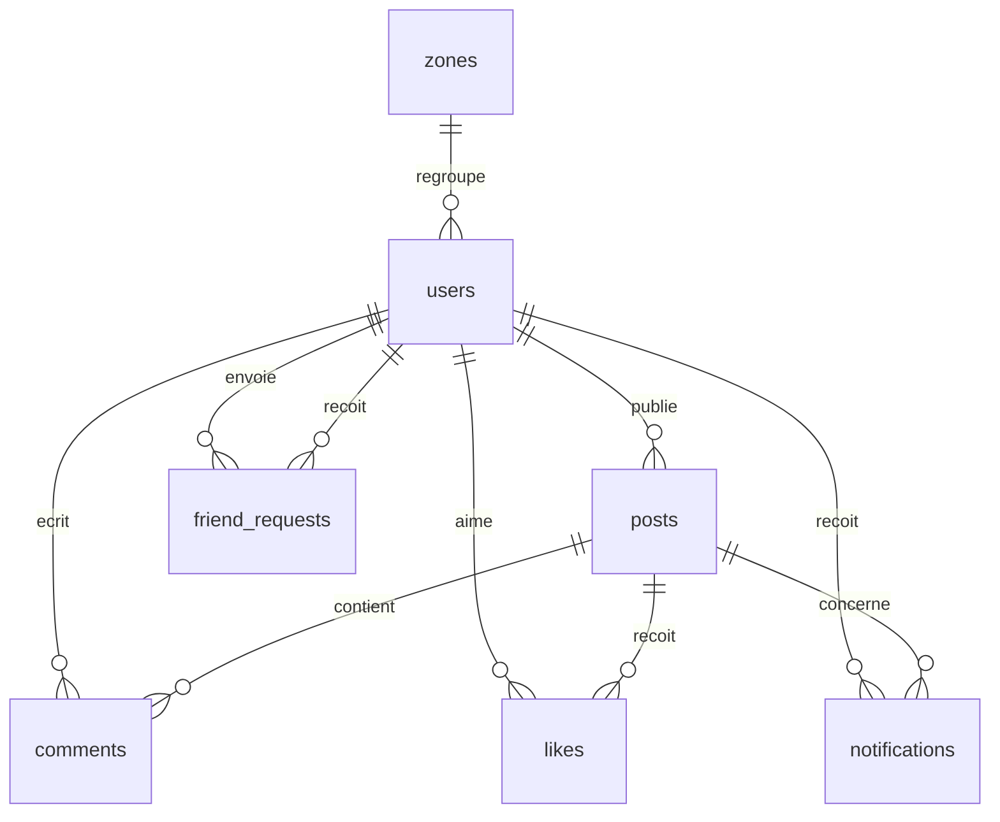

# Base de données

PostgreSQL 16, schéma décrit dans [`backend/db/schema.js`](../backend/db/schema.js) et versionné dans [`backend/db/migrations`](../backend/db/migrations).

## Choix de l'ORM : Drizzle

| Critère | Drizzle | Prisma |
|---|---|---|
| Moteur | Pur JavaScript, au-dessus du driver `pg` | Moteur binaire à télécharger selon la plateforme |
| Image Docker | Rien à ajouter à `node:20-alpine` | Binaire spécifique à musl, génération du client au build |
| Requêtes | Proches du SQL (jointures, sous-requêtes) | API plus abstraite, SQL brut pour les cas avancés |
| Migrations | Fichiers SQL lisibles, générés depuis le schéma | Fichiers SQL générés depuis `schema.prisma` |
| Langage du schéma | JavaScript, comme le reste du projet | DSL propre à Prisma |

Drizzle est retenu : pas de binaire à gérer dans les conteneurs et la CI, des requêtes qui restent lisibles pour quelqu'un qui connaît le SQL (utile pour le stagiaire et les reviews), et un schéma écrit dans le même langage que l'API.

## Modèle conceptuel

## Dictionnaire des données

### zones

| Colonne | Type | Contraintes | Description |
|---|---|---|---|
| id | serial | PK | Identifiant |
| name | text | non nul | Nom du quartier |
| city | text | non nul | Ville |

Unicité sur (name, city). La zone pilote (5 quartiers de Toulouse) est insérée par la migration `0002_pilot_zones` : ce sont des données de référence, présentes dans tous les environnements.

### users

| Colonne | Type | Contraintes | Description |
|---|---|---|---|
| id | uuid | PK, généré | Identifiant |
| first_name | text | non nul | Prénom |
| last_name | text | non nul | Nom |
| email | text | non nul, unique | Email en minuscules |
| password | text | non nul | Hash bcrypt, jamais renvoyé par l'API |
| bio | text | non nul, défaut `''` | Présentation |
| avatar | text | non nul, défaut `''` | URL de l'avatar |
| zone_id | integer | FK zones, restrict, nullable | Quartier choisi à l'inscription (obligatoire à l'inscription, null pour les comptes plus anciens) |
| created_at | timestamptz | non nul, défaut `now()` | Date d'inscription |

Aucune adresse n'est stockée (RGPD, persona Chloé) : seul le quartier est connu, et c'est la seule information de localisation visible sur un profil.

### posts

| Colonne | Type | Contraintes | Description |
|---|---|---|---|
| id | uuid | PK | Identifiant |
| author_id | uuid | FK users, cascade | Auteur |
| content | text | non nul | Texte de la publication |
| created_at | timestamptz | non nul, indexé | Date de publication |

### comments

| Colonne | Type | Contraintes | Description |
|---|---|---|---|
| id | uuid | PK | Identifiant |
| post_id | uuid | FK posts, cascade, indexé | Publication commentée |
| author_id | uuid | FK users, cascade | Auteur |
| content | text | non nul | Texte |
| created_at | timestamptz | non nul | Date |

### likes

| Colonne | Type | Contraintes | Description |
|---|---|---|---|
| post_id | uuid | PK (avec user_id), FK posts, cascade | Publication |
| user_id | uuid | PK (avec post_id), FK users, cascade | Utilisateur |
| created_at | timestamptz | non nul | Date |

La clé primaire composée garantit un seul like par utilisateur et par publication.

### friend_requests

| Colonne | Type | Contraintes | Description |
|---|---|---|---|
| id | uuid | PK | Identifiant |
| from_id | uuid | FK users, cascade | Demandeur |
| to_id | uuid | FK users, cascade | Destinataire |
| status | enum `pending`, `accepted` | non nul, défaut `pending` | État |
| created_at | timestamptz | non nul | Date |

Unicité sur (from_id, to_id).

### notifications

| Colonne | Type | Contraintes | Description |
|---|---|---|---|
| id | uuid | PK | Identifiant |
| user_id | uuid | FK users, cascade, indexé | Destinataire |
| from_id | uuid | FK users, cascade | Auteur de l'action |
| type | enum `like`, `comment` | non nul | Type d'action |
| post_id | uuid | FK posts, cascade | Publication concernée |
| read | boolean | non nul, défaut `false` | Lue ou non |
| created_at | timestamptz | non nul | Date |

## Modifier le schéma

1. Modifier `backend/db/schema.js`.
2. Générer la migration : `npm run db:generate -w backend -- --name <description>`.
3. Relire le fichier SQL créé dans `backend/db/migrations`, puis l'appliquer : `npm run db:migrate -w backend`.
4. Commiter le schéma **et** la migration dans le même commit (`feat(database): ...`).

Une migration déjà fusionnée dans `develop` ne se modifie plus : on en crée une nouvelle.
