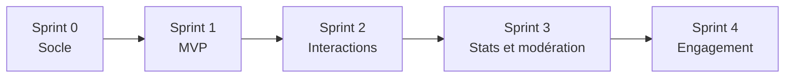

# 📋 Backlog LocalLoop par sprint

Ce dossier rassemble le backlog du projet, rangé **par sprint** et **dans l'ordre où les tâches doivent être faites**.
Les identifiants `LL-<id>` sont ceux des tickets Notion. Le contenu détaillé de chaque ticket (critères d'acceptation, maquettes) reste dans Notion.

| Sprint | Dates | Objectif | Charge | Fichier |
|---|---|---|---:|---|
| Sprint 0 | 09/10 → 09/11/2026 | Socle technique : base, outillage, CI, contrat d'erreur, 800×600 | 19 J/H | [sprint-0.md](sprint-0.md) |
| Sprint 1 | 10/11 → 10/12/2026 | MVP : quartier, fil local, publications, profil, erreurs front, US stagiaire | 21 J/H | [sprint-1.md](sprint-1.md) |
| Sprint 2 | 11/12/2026 → 11/01/2027 | Visibilité, réactions et commentaires, édition du profil, participation | 11,75 J/H | [sprint-2.md](sprint-2.md) |
| Sprint 3 | 12/01 → 12/02/2027 | Statistiques, modération, erreurs réseau | 6,5 J/H | [sprint-3.md](sprint-3.md) |
| Sprint 4 | 13/02 → 13/03/2027 | Engagement : compteurs, badges, événements dans le fil | 3,5 J/H | [sprint-4.md](sprint-4.md) |

La charge additionne les estimations des tâches (78 tâches, 61,75 J/H). Les EPIC et les US qui ont des sous-tâches ne sont pas comptés en plus.

## Statuts

Les statuts sont ceux **vérifiés dans le code** de `develop` au 20/11/2026, pas ceux déclarés dans Notion.

| Statut | Signification |
|---|---|
| ✅ Fait | Livré dans `develop` et conforme au ticket |
| 🟡 Partiel | Commencé dans `develop`, des critères manquent |
| ♻️ À reprendre | Une version existe dans le MVP (fichier JSON `backend/lib/db.js`), à refaire sur PostgreSQL et au périmètre LocalLoop |
| ⬜ À faire | Rien dans le code |

## Enchaînement des sprints

Chemins critiques entre sprints :

- **Base de données** : LL-125 (S0) → LL-229 zones (S1) → LL-191 Post → LL-171 visibilité (S2) → LL-226 masquage (S3).
- **Outillage** : LL-202 Storybook, LL-203 Swagger, LL-205 Vitest/Playwright (S0) sont des prérequis du stage (LL-211, LL-213 en S1) et de toutes les stories et tests E2E.
- **Erreurs** : LL-176 à LL-178 (S0) → LL-180 à LL-183 (S1) → LL-184 à LL-186 (S3).
- **Événements** : LL-215 à LL-218 (S1) → LL-219, LL-220 (S2) → LL-221 (S4).
- **Signalement** : LL-222 à LL-224 (S1) → LL-225 à LL-227 (S3).
- **Statistiques** : réactions et commentaires (S2) → LL-158 (S3) → LL-159 badges (S4).

## Schéma de base : qui crée quelle table

Chaque sprint ajoute les tables et colonnes dont il a besoin, par migration :

| Sprint | Tables et colonnes |
|---|---|
| S0 (LL-125) | `zones` avec seed des quartiers pilotes, `users`, `posts` (base), `reactions`, `comments` |
| S1 | `users.zone_id` (LL-229), `posts.zone_id`, `category`, `photo` (LL-191), `events` (LL-215), `reports` (LL-222) |
| S2 | `posts.visibility` (LL-171), `event_participants` (LL-219) |
| S3 | `users.role` USER / MODERATOR (LL-225), `posts.hidden_at` (LL-226) |

Aucune donnée d'adresse n'est stockée (RGPD).

## Corrections apportées au backlog Notion

Revue du 20/11/2026 :

| Ticket | Correction | Raison |
|---|---|---|
| LL-235 Retirer le module Amis | S1 → **S0**, avant LL-125 | Éviter de migrer `friends` et `notifications` vers PostgreSQL pour rien |
| LL-233 Bug secret JWT et erreurs 500 | S1 → **S0** | Sous-tâche de LL-161 (S0) : sinon la US ne peut pas être close en S0 |
| LL-160 Visibilité (et LL-171 à 175) | S1 → **S2** | Sprint 1 surchargé ; la visibilité n'est utile qu'avec le fil en place |
| LL-231 Filtrer le fil par zone | **Supprimé** | Doublon de LL-193 « Route API du fil local paginé (par zone) » |
| LL-229 Zones | **Première tâche du S1** | LL-191, LL-193, LL-139 et LL-215 en dépendent |
| LL-120, 123, 125 | Périmètre réduit aux tables du S0 | Les tickets stagiaire (LL-215, LL-222) ajoutent eux-mêmes `events` et `reports` |
| LL-143, 146, 149, 150, 195, 147, 151 | « Terminé » → ♻️ À reprendre | Faits sur le fichier JSON du MVP, pas sur PostgreSQL |
| LL-165 à 168 (statistiques) | « À faire » → ♻️ À reprendre | Déjà fusionnés par la PR #16 (`FB-158`), sur le fichier JSON |
| Tickets S0 « En review » sans code | → ⬜ À faire ou 🟡 Partiel | Aucune branche ni PR correspondante |
